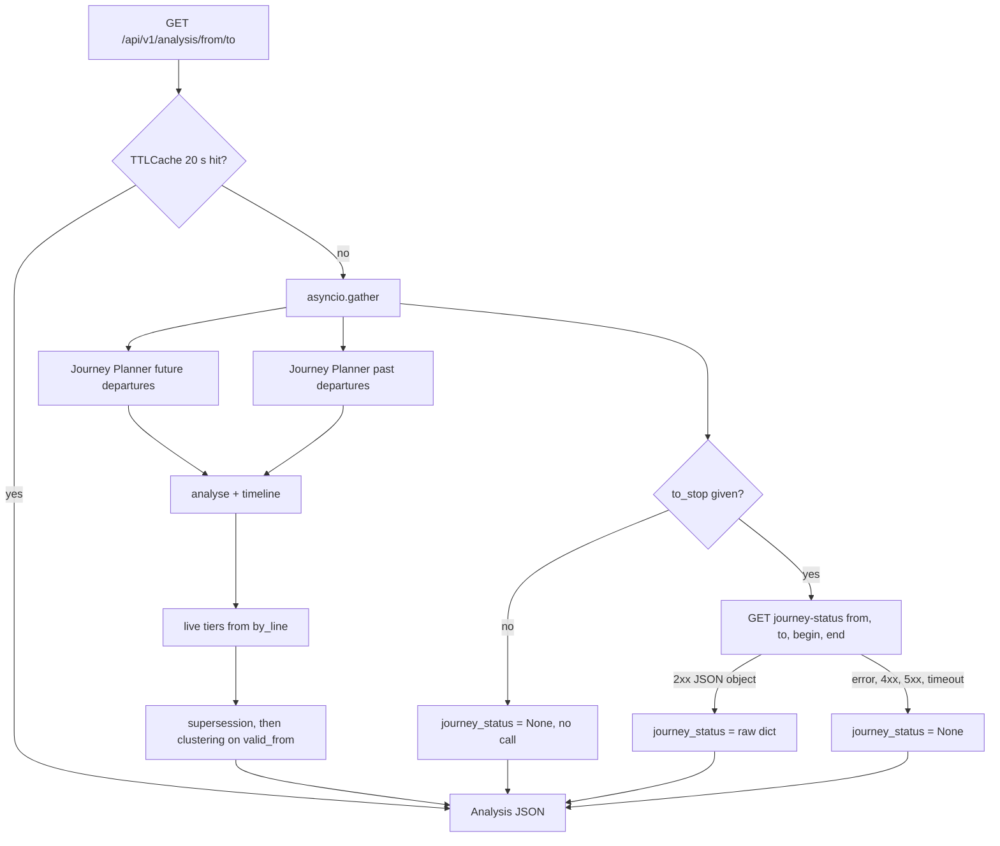
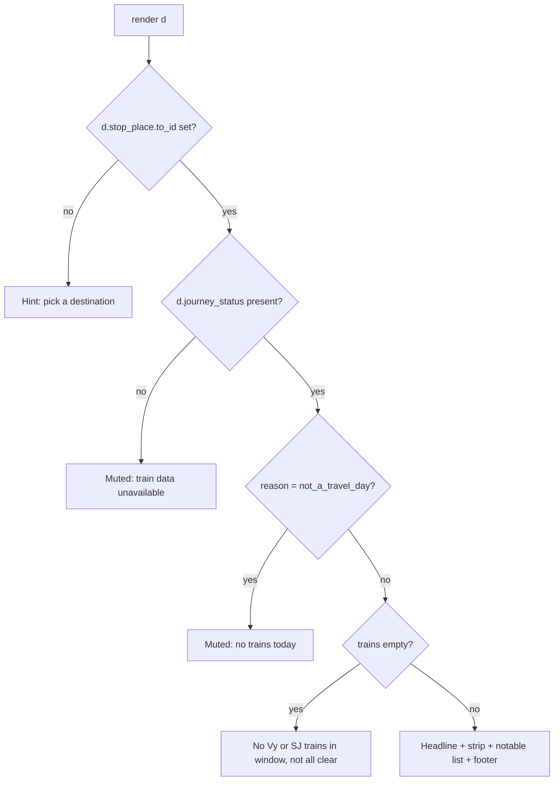

# Replace KIX situation/impact enrichment with journey-status - Plan

## Goal Capsule

- **Objective:** Remove every use of the KIX `/situation` and `/impact` endpoints, and add a "trains on this route" panel fed by `https://kix-avvik.entur.io/notification-api/v1/journey-status`.
- **Authority:** the user's request, then repo conventions in `togpuls/CLAUDE.md`, then this plan. The kix-avvik contract (`contracts/notifications/v1/openapi.json` in the kix-avvik repo) wins over this plan on field meaning.
- **Execution profile:** work on branch `journey-status` in the existing worktree. No push and no PR unless the user asks.
- **Stop conditions:** stop and ask if a live journey-status response contradicts the contract fields this plan relies on, or if removing the KIX branches changes the risk tiers users see today.
- **Done when:** the Definition of Done below holds.

---

## Product Contract

### Summary

Delete the KIX `/situation` and `/impact` clients and all code that reads their output. Add a best-effort journey-status read for the selected from→to route. Show it in a new panel: a count of the disrupted trains, the day's outlook sentence, each train in the dashboard window coloured by status and marked as recorded or forecast, the trains worth attention, and an honest coverage note.

### Problem Frame

togpuls calls two KIX endpoints on a Cloud Run host that kix-avvik has shut down. Both calls return 404 and fail silently. Users get no KIX data today: the risk chips and tooltip come from a live-data fallback, and the cancellation and delay pills never render. `/situation` is also marked deprecated in kix-avvik. The code that consumes these responses is now dead weight that hides what the dashboard actually shows.

kix-avvik now publishes a public, versioned read, `journey-status`, that grades every Vy and SJ train on a route for today. It covers recorded delays, forecasts, and trains taken out of the timetable. None of this is visible in togpuls today.

### Requirements

**Removal of KIX situation/impact**

- R1. togpuls makes no calls to `/situation` or `/impact`, and no code reads their output (backend, CLI, frontend, and the macOS menu bar app in `macos/togpuls_bar.py`).
- R2. UI that only rendered KIX data is removed: the cancellation and delay pills, KIX-only rows in the situation tooltip, and KIX cause codes. Risk tiers keep coming from live Journey Planner data, as they do today.
- R3. Grouping of messages about one incident, and hiding of resolved situations, keep working without the KIX `onset`.

**Journey-status read**

- R4. When a destination is selected, the analysis reads journey-status for that from→to pair over the dashboard window and returns it in the analysis response.
- R5. A failed, slow, rate-limited, or rejected journey-status read never fails the analysis.
- R6. With no destination selected, togpuls makes no journey-status call.

**Trains-on-route panel**

- R7. The panel headline counts the disrupted trains in the window: red, yellow, or taken out of the timetable, out of the total. Below it, the journey-status summary sentence in the user's language (Norwegian or English) shows as an outlook line. The outlook line is left out when the sentence is empty.
- R8. The panel shows every train in the window in departure order. Each train is coloured by its level and drawn as recorded (filled), forecast (ring), or unknown (grey ring). A now marker uses the server's time.
- R9. The panel lists the trains worth attention: red or yellow trains, trains taken out of the timetable, and trains with a replacement bus. Each row shows departure time, line, destination, and a status text.
- R10. The panel states its limits: only Vy and SJ trains are covered, unknown trains read as unknown, and an empty list never reads as "all clear".
- R11. With no destination selected, the panel asks the user to pick one. When the read failed, the panel says the data is unavailable.
- R12. Colour is never the only carrier of a train's status. Each train marker has a text label.

**Quality**

- R13. A standard-library test covers the journey-status client and the window computation.

### Acceptance Examples

- AE1. Covers R6, R11. **Given** Oslo S with no destination, **when** the dashboard loads, **then** no journey-status request is sent and the panel says to pick a destination.
- AE2. Covers R5, R11. **Given** journey-status answers 429 or 503, **when** the analysis is computed, **then** the analysis returns 200 and the panel says the train data is unavailable.
- AE3. Covers R9. **Given** a train with `removed_from_plan: true`, **then** its row says it was taken out of the timetable, not "cancelled". **Given** `bus_for_train: true` as well, the row also says a replacement bus runs.
- AE4. Covers R4. **Given** the time is 23:10 in Oslo and the horizon is 90 min, **then** the read asks for `begin=21:40` and `end=00:40`, and the trains after midnight are in the answer.
- AE5. Covers R8, R10. **Given** a train with `state: unknown` and `level: grey`, **then** it shows as a grey ring labelled unknown and is counted as unknown in the footer, not as on time.

### Scope Boundaries

- No `journey-alerts` read: per-train notification text and alternative journeys are out.
- No webhook subscriptions or credentials.
- No fan-out to several destinations for the departure-only view.
- Risk chips and the summary card border are not re-derived from journey-status grades.
- No nynorsk: togpuls has Norwegian (bokmål) and English only, so `summary_nn` is ignored.

#### Deferred to Follow-Up Work

- Rendering trips with a change (`trip` set on a row) with their legs. kix-avvik has `TRIP_PLANS_ENABLED` off in prd, so `trip` is always null today. Rows with `trip` set render with their first-leg fields like any other row.
- Printing journey-status in the CLI (`python -m togpuls.main`). The CLI drops the KIX calls and gains nothing in this plan.
- Colouring the forward timeline buckets from forecasts.

### Sources

- kix-avvik repo: `docs/integrations/notification-api.md`, sections "The journey-status read", "Rate limits and quotas", "Environments".
- kix-avvik repo: `contracts/notifications/v1/openapi.json`, schemas `JourneyStatus` and `TrainStatus`.
- kix-avvik repo: `disruptions/api/main.py` marks `/situation` as `deprecated=True`.
- kix-avvik repo: `docs/plans/2026-07-29-001-feat-varsel-impact-llm-message-plan.md` records that togpuls points at a shut-down host.
- Live check on 2026-11-06: the Cloud Run host returned 404. `journey-status` for `NSR:StopPlace:337` → `NSR:StopPlace:11` returned 94 trains (3 red, 15 yellow, 22 grey).

---

## Planning Contract

### Key Technical Decisions

- KTD1. **Remove `/situation` and `/impact` outright.** (session-settled: user-directed — chosen over pointing both at `kix-avvik.entur.io`: the user wants them gone, not repaired.) Governs R1, R2.
- KTD2. **journey-status is the only new KIX source.** (session-settled: user-directed — chosen over starting with `journey-alerts`: the user asked for journey-status.) Governs R4, R7–R10.
- KTD3. **Pass the journey-status response through unchanged.** The analysis gets a new field `journey_status` holding the raw response dict, or `None`. It is typed `Any` in `togpuls/models.py`, as `estimate` was. The contract is versioned (`/v1`), so a trimmed copy would only add mapping code. The frontend reads the fields it needs.
- KTD4. **The window matches the dashboard window.** `begin` is now minus `TIMELINE_SPAN_MIN`, and `end` is now plus `horizon_min`. Both are formatted as `HH:MM` in Europe/Oslo time with stdlib `zoneinfo`. Send no `days` parameter. The contract handles windows over midnight (it treats `end` before `begin` as overnight, and with no `days` it also covers yesterday's window). The widest window is 90 + 360 = 450 min, so `begin` never equals `end`.
- KTD5. **The read is best-effort and runs alongside the Journey Planner queries.** It needs only from, to and now, so it joins the existing `asyncio.gather` with the two departure queries. Any `httpx.HTTPError`, non-2xx status (422, 429, 503), invalid JSON, or non-object body maps to `None`. The timeout is 5 s; the endpoint normally answers in about 0.1 s. Send `ET-Client-Name: kengu-togpuls`, the value `togpuls/clients/journey_planner.py` already uses. The client allows at most 6 reads per minute per stop pair per process and returns `None` above that. The 20 s analysis cache does not bound this on its own, because each `horizon_min` value has its own cache entry and its own read.
- KTD6. **Collapse the tier loop to the live path.** With no KIX estimate, `_compute_analysis` keeps only the code that builds `estimate = {"alert": {...}}` from `train_movements.by_line`. The KIX-floor branch and `kix_tier` go. `reportType=general` messages get no tier, which is today's behaviour since `kix_tier` is always `None`. The `estimate` key name stays so the frontend tier code and the macOS menu bar app's tier read (`estimate.alert.alert_tier` in `macos/togpuls_bar.py`) keep working; comments say it holds live-derived rates.
- KTD7. **Use `valid_from` as the incident start, for grouping only.** `_parse_onset` reads the situation's `valid_from` (SIRI `validityPeriod.startTime`, already on every situation) instead of `estimate.onset`. Only the 5-min sibling test in `_cluster_situations` uses it. `_resolve_superseded` drops its onset gate and `RESOLVE_ONSET_MIN`. A confirmed all-clear keeps hiding every same-lines incident whose lines have recovered, which is what happens today because the KIX onset is always missing. Feeding `valid_from` to that gate would switch on a 120-min cut-off that production has never had. Long-running incidents would then show as live again after their all-clear, while the all-clear itself stays hidden. The sibling test is inert today too, so grouping is a behaviour change on real data.
- KTD8. **Drop `cause_code` end to end.** Its only source was KIX `category`. The cause chip keeps the text-extracted `cause_text`. `resolveCause` loses its code branch.
- KTD9. **A separate panel, not blended into the timeline.** journey-status covers Vy and SJ rail only, while the timeline covers every operator at the station. Mixing them would make the timeline's counts mean two things.
- KTD10. **The panel follows the existing block pattern.** It is a `section.block` placed after the summary card and before the situations block. It has an `h2`, a `block-headline` (the disrupted-train count), the outlook line, the train strip, the notable-trains list, and a muted footer. `render(d)` draws it, so the language toggle re-renders it through the existing `i18n:change` handler.
- KTD11. **Use standard-library `unittest` with `httpx.MockTransport` for tests.** pytest is not in `requirements.txt`, and the repo has no tests. `httpx.MockTransport` comes with httpx, so no new dependency is needed.

### High-Level Technical Design

Backend data flow for one analysis request:

Panel state selection in the frontend:

### Assumptions

- `python:3.12-slim` ships the IANA database that `zoneinfo` needs. If it does not, add `tzdata` to `requirements.txt` (see Open Questions).

### Open Questions

- Deferred: does `zoneinfo.ZoneInfo("Europe/Oslo")` resolve inside the `python:3.12-slim` container? Check during U1. If it fails, add `tzdata` to `requirements.txt`. Not blocking.

### Risks

| Risk | Mitigation |
|---|---|
| Another anonymous caller exhausts the shared journey-status limits (3 000/min global, 30/min per stop pair). | A 429 maps to `None` and the panel says the data is unavailable. |
| togpuls itself burns the per-pair limit, because each `horizon_min` value has its own analysis cache entry. | The client guard caps togpuls at 6 reads per minute per pair per process (KTD5). Several instances multiply the cap; `togpuls/CLAUDE.md` already says to run one. |
| kix-avvik answers 503 `plan_not_loaded` after a deploy. | Same `None` path; the next poll recovers. |
| `valid_from` groups different situations than the old (inert) onset logic did. | Compare grouped cards before and after on a few live stations during U2. |
| Same-place pairs (for example `NSR:StopPlace:337` and `NSR:StopPlace:59872`, both Oslo S) give 422. | 422 maps to `None`. The common-stations list holds no such pairs. |

---

## Implementation Units

### U1. Journey-status client

- **Goal:** Replace `togpuls/clients/disruptions.py` with a client that reads journey-status for one route and window.
- **Requirements:** R4, R5, R13; KTD4, KTD5, KTD11.
- **Dependencies:** none.
- **Files:**
  - Delete `togpuls/clients/disruptions.py`.
  - Create `togpuls/clients/journey_status.py`.
  - Create `tests/__init__.py` (empty) and `tests/test_journey_status.py`.
- **Approach:**
  1. One async function takes the shared `httpx.AsyncClient`, `from_stop`, `to_stop`, `now`, and the past and future spans in minutes. It returns the response dict or `None`.
  2. One small pure helper turns `now` and the two spans into `begin` and `end` strings (KTD4). Keep it separate so the test can call it without HTTP.
  3. The base URL is a module constant with the prd host.
  4. A rate guard per stop pair (KTD5): a module-level dict maps (from, to) to the times of recent reads. With 6 reads in the last 60 s for a pair, return `None` without a request. Mark it `ponytail:` as a per-process cap.
- **Patterns to follow:** the best-effort, never-raise shape of the deleted `fetch_impact`; the header dict in `togpuls/clients/journey_planner.py`.
- **Test scenarios:**
  - Happy path: a 200 JSON object is returned unchanged, and the request carries `from_stop`, `to_stop`, `begin`, `end` and the `ET-Client-Name` header, with no `days`.
  - Window: `now` = 2026-11-06 12:00 Europe/Oslo with spans 90/90 gives `10:30` and `13:30`.
  - Window over midnight: `now` = 23:10 Oslo with spans 90/90 gives `21:40` and `00:40`. Covers AE4.
  - Window with UTC input: a `now` in UTC still formats in Oslo time (13:00Z in winter gives `12:30` and `15:30` with spans 90/90).
  - DST: `now` = 2027-03-28 03:30 Oslo (just after the spring shift) with spans 90/90 gives `01:00` and `05:00`, because the offset is applied to the absolute times.
  - Errors: 422, 429 with `Retry-After`, and 503 each return `None`. Covers AE2.
  - Errors: a transport error and a timeout return `None`.
  - Errors: a 200 with a non-JSON body, and a 200 with a JSON list, return `None`.
  - Rate guard: with a patched clock, the 7th call for one pair within 60 s returns `None` and sends no request, a different pair still reads, and the first pair reads again after 60 s. The other tests clear the guard state in `setUp`.
- **Verification:** the test file passes, and a live call for Oslo S → Drammen returns a dict with `trains`.

### U2. Backend wiring and KIX removal

- **Goal:** Wire the new read into the analysis, and remove every backend use of the KIX estimate and prediction.
- **Requirements:** R1, R3, R4, R5, R6; KTD3, KTD5, KTD6, KTD7, KTD8.
- **Dependencies:** U1.
- **Files:**
  - Modify `togpuls/api/app.py`, `togpuls/analysis.py`, `togpuls/models.py` and `togpuls/main.py`.
  - Modify `tests/test_journey_status.py` (add the clustering scenarios).
  - Modify `togpuls/CLAUDE.md`: add `clients/journey_status.py` to the architecture table, and replace "There is no test suite yet" with the unit-test command.
- **Approach:**
  1. `togpuls/api/app.py`:
     - Start the journey-status read in the same `asyncio.gather` as the two Journey Planner queries, only when `to_stop_place_id` is set.
     - Set `analysis["journey_status"]` to the result.
     - Remove `fetch_estimates`, `fetch_impact` and the prediction attach loop.
     - Collapse the tier loop per KTD6.
     - Point `_parse_onset` at `valid_from`, and remove the onset gate and `RESOLVE_ONSET_MIN` from `_resolve_superseded`, per KTD7.
     - Replace the "KIX-estimater" wording in `API_DESCRIPTION`.
  2. `togpuls/analysis.py`: drop the `estimates` parameter, the `estimate` lookup and `cause_code`. Each situation starts with `estimate: None`. `collect_situation_ids` loses its last caller, so delete it.
  3. `togpuls/models.py`:
     - Remove `prediction` and `cause_code`.
     - Add `journey_status: Any` to `Analysis`.
     - Rewrite the `estimate` comment to say it holds live-derived rates.
  4. `togpuls/main.py`: remove the KIX calls and the prediction attach loop. The CLI prints what it printed before.
  5. `togpuls/CLAUDE.md`: record the new client and the test command.
- **Patterns to follow:** the existing `asyncio.gather` in `_compute_analysis`; the 502 mapping for Journey Planner errors stays as it is.
- **Test scenarios:**
  - Clustering: two situations with shared lines, the same `report_type`, and `valid_from` 3 min apart get one `event_id`.
  - Clustering: the same pair with `valid_from` 10 min apart gets two `event_id` values.
  - Clustering: a situation with an empty `valid_from` still groups by identical summary text.
  - Supersession: a confirmed all-clear hides a recovered same-lines incident whose `valid_from` is 3 h earlier, as today (no time gate).
  - Integration (manual): `GET /api/v1/analysis/NSR:StopPlace:337/to/NSR:StopPlace:11` returns `journey_status` with `trains`. Covers R4.
  - Integration (manual): `GET /api/v1/analysis/NSR:StopPlace:337` returns `journey_status: null`, and no request goes to kix-avvik. Covers AE1.
  - Integration (manual): with the base URL pointed at an unreachable host, the corridor analysis still returns 200 with `journey_status: null`. Covers AE2.
- **Verification:** the tests pass, the manual checks hold, and a search of the code finds no `situation?id`, `/impact`, `run.app`, `fetch_estimates`, `fetch_impact`, `prediction` or `cause_code`.

### U3. Frontend: remove KIX-only UI

- **Goal:** Remove the UI that only rendered KIX data. Keep the live tier chip and the tooltip's live rows.
- **Requirements:** R1, R2; KTD6, KTD8.
- **Dependencies:** U2.
- **Files:** modify `togpuls/static/app.js`, `togpuls/static/i18n.js`, `togpuls/static/styles.css` and `macos/togpuls_bar.py`.
- **Approach:**
  1. `togpuls/static/app.js`:
     - Remove the `.sit-cancel` and `.sit-prediction` spans from both card templates.
     - Remove `applyTripPrediction` and its helpers, and the `TRIP_*` constants.
     - Remove the `prediction` threading in `groupSituations` and `buildPerLineSituations`.
     - Remove the `cause_code` threading, and the code branch in `resolveCause`.
  2. `applyHistory` keeps the cause, lines, `cancel_rate` and `trouble_rate` rows. Remove the rows for `trouble_lift`, `delay_p50`, `delay_p90`, `exp_disruption_min`, `n_situations` and `matched_hour`, and the reopen and impact spreads.
  3. `togpuls/static/i18n.js`: remove the keys only those parts used (`sit_delay*`, `sit_cancel_pill`, `sit_tip_*`, and the removed `sit_hist_*` rows) in both languages. Keep `tier_label.*`, `sit_hist_cause`, `sit_hist_lines`, `sit_hist_cancel_rate` and `sit_hist_trouble_rate`. Reword the About text (`about_data_b`) in both languages. It must stop saying the data includes KIX estimates, and it should say instead that route views show Vy and SJ train status from KIX.
  4. `togpuls/static/styles.css`: remove the `.sit-cancel` and `.sit-prediction` rules. Keep the `.sit-meta` rules the cause chip uses.
  5. `macos/togpuls_bar.py`: drop the `cause_code` reads in the situation grouping and the cause line, and keep `cause_text`. The tier read stays as it is (KTD6).
- **Patterns to follow:** none new; this unit only deletes.
- **Test expectation:** none automated, because the repo has no frontend tests and this unit only deletes code. Manual check below.
- **Verification:**
  - Situation cards render with tier chip, cause chip and tooltip in both grouped and per-line views.
  - The browser console shows no errors.
  - A search of the static files and `macos/togpuls_bar.py` finds no `prediction`, `cause_code` or removed i18n key.
  - `python -m compileall macos/togpuls_bar.py` passes.

### U4. Trains-on-route panel

- **Goal:** Show journey-status as a new dashboard panel.
- **Requirements:** R7–R12; KTD9, KTD10.
- **Dependencies:** U2. U3 should land first because both edit the same render code.
- **Files:** modify `togpuls/static/index.html`, `togpuls/static/app.js`, `togpuls/static/styles.css` and `togpuls/static/i18n.js`.
- **Approach:**
  1. `togpuls/static/index.html`: add a `section.block` after the summary card. Give it ids for the headline, strip, list and footer, so `togpuls/static/app.js` can find each part (repo rule: markup and `togpuls/static/app.js` change in the same commit).
  2. A `renderJourneyStatus(d)` function, called from `render(d)`, picks one of the states in the panel diagram above.
  3. Headline (R7): count from `trains`, for example "3 of 41 trains disrupted". A train counts as disrupted when its `level` is red or yellow, or when `removed_from_plan` is set. Below it goes an "Outlook" line with `summary` or `summary_en` by `currentLang()`, left out when null. There is no "nothing to report" line.
  4. Strip: one marker per train in departure order. It wraps onto more lines and never scrolls sideways.
     - The strip is one element with `role="img"` and an `aria-label` that gives the counts per level, for example "41 trains: 2 red, 5 yellow, 30 green, 4 unknown". Markers are not focusable, so keyboard users pass the strip in one step.
     - Each marker takes its fill or ring from `state` and its colour from `level`, using the existing `--signal-*` tokens. Tap targets are at least 24 px.
     - Each marker has a `title` such as "R12 Kongsberg 14:09 · forecast · +6 min". Tapping or hovering a marker shows the same text in one shared readout line under the strip.
     - The now marker is a labelled divider ("now"). It sits between the last train whose departure (expected, else planned) is at or before the response's `now` and the next train. When all trains are on one side, it sits at that end of the strip.
  5. Notable list: trains with `level` red or yellow, `removed_from_plan` or `bus_for_train`.
     - Each row shows the time, line, destination and a status text. The line is the public code after the last `:` in `line`; a null line or destination shows nothing.
     - Status text: the first rule that matches wins.
       1. `removed_from_plan`: taken out of the timetable (AE3).
       2. `cancelled`: "cancelled".
       3. `state` confirmed with `delay_min` above 0: "+N min".
       4. `state` predicted with `delay_p50_min` above 0: "expected +N min".
       5. Otherwise a short word for the level (red or yellow), from i18n.
     - When `bus_for_train` is set, the row also says a replacement bus runs.
  6. Safety: journey-status is third-party data.
     - Set every string from it with `textContent` or `setAttribute`, never `innerHTML`.
     - Check `level` against red, yellow, green and grey, and `state` against confirmed, predicted and unknown, before using either in a class name. Any other value renders as grey and unknown.
  7. Footer:
     - "Vy and SJ trains only".
     - The count of unknown trains (AE5).
     - The time of the timetable `as_of`.
  8. No-destination hint and unavailable state per R11.
- **Patterns to follow:**
  - Block markup: the situations and platforms blocks in `togpuls/static/index.html` (`h2`, `block-headline`, muted empty state).
  - Time formatting: `fmtTime`.
  - Text: `t()` and `data-i18n` attributes.
  - Colours: the `--signal-*` tokens and the light and dark theme variables in `togpuls/static/styles.css`.
- **Test expectation:** no automated frontend tests exist. Run the manual scenarios below against live data and against a saved response edited by hand.
- **Test scenarios (manual):**
  - Oslo S → Drammen shows the headline, a strip whose count matches `trains`, and a list of only the noteworthy trains.
  - Station-only Oslo S shows the destination hint (AE1).
  - Pointing the backend at an unreachable host shows the unavailable state (AE2).
  - An edited response with `removed_from_plan: true` and `bus_for_train: true` shows the timetable and replacement-bus wording (AE3).
  - A grey `unknown` train shows as a grey ring with an "unknown" label and is counted in the footer (AE5).
  - An edited response with empty `trains` shows the "no Vy or SJ trains in the window" state, not all clear.
  - An edited response with a red train that has `cancelled: true` and no delay figure shows "cancelled", not "+null min".
  - An edited response with `<b>x</b>` in `summary` and `destination` shows the tags as literal text.
  - Toggling the language swaps the outlook line between `summary` and `summary_en` and translates every label.
  - The now divider sits between the last departed and the next train, and at an end when all trains are past or all are future.
  - Light and dark mode at 375, 700 and 1200 px: the strip wraps without page overflow, the markers stay readable, and tapping a marker fills the readout line.
- **Verification:** all manual scenarios hold, and the browser console shows no errors.

---

## Verification Contract

| Gate | Command or check | Units |
|---|---|---|
| Compile | `python -m compileall togpuls macos/togpuls_bar.py` from the repo root | U1, U2, U3 |
| Unit tests | `python -m unittest discover -s tests` from the repo root | U1, U2 |
| App smoke | `uvicorn togpuls.api.app:app --reload`, then `GET /api/v1/health`, `GET /api/v1/analysis`, `GET /api/v1/analysis/NSR:StopPlace:337/to/NSR:StopPlace:11` | U2 |
| No KIX leftovers | Code search for `situation?id`, `/impact`, `run.app`, `fetch_estimates`, `fetch_impact`, `prediction`, `cause_code` finds nothing outside `docs/` | U1, U2, U3 |
| Container timezone | `zoneinfo.ZoneInfo("Europe/Oslo")` resolves in the `togpuls/Dockerfile` image | U1 |
| UI | Light and dark, 375, 700 and 1200 px, per `togpuls/CLAUDE.md` | U3, U4 |

---

## Definition of Done

- R1–R13 hold, and AE1–AE5 behave as written.
- Every gate in the Verification Contract passes.
- `togpuls/CLAUDE.md` and the About text (`about_data_b` in `togpuls/static/i18n.js`, both languages) say nothing that is wrong about KIX.
- No code from abandoned approaches is left in the diff.
- Work is committed on branch `journey-status`; nothing is pushed unless the user asks.
